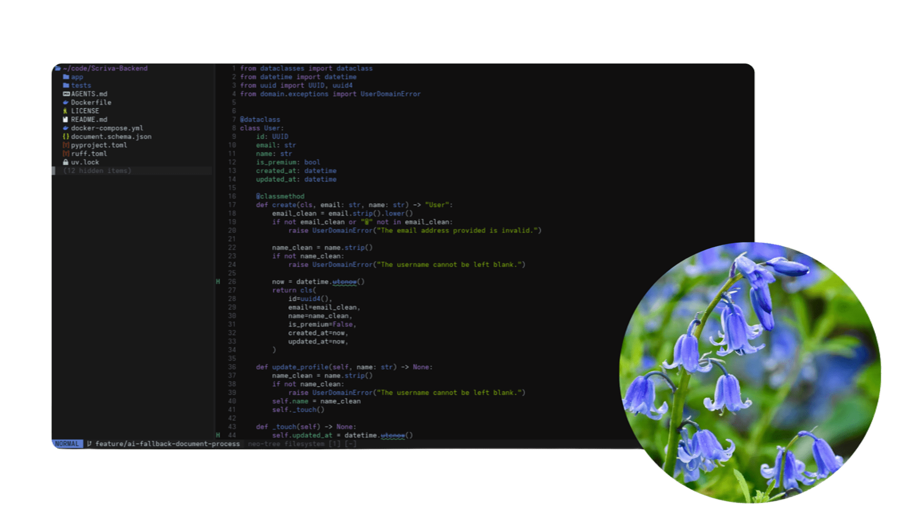

# bluebells.nvim

A dark Neovim colorscheme inspired by bluebells.



## The idea

Bluebells are such a beautiful flower. On their own they are lovely, but when
a whole forest floor is covered with them, it becomes something truly magical:
a sea of blue and purple stretching out in the middle of the green woods, calm
and quiet at the same time.

This colorscheme tries to capture that feeling. The palette is built mostly
around those colors: violets and blues for the code, soft mossy greens as the
natural background tone of the forest, and a near-black canvas so everything
stands out gently without being harsh on the eyes.

## Installation

Using [lazy.nvim](https://github.com/folke/lazy.nvim):

```lua
return {
  {
    "RamCodeZ3/Bluebells.neovim",
    name = "bluebells",
    main = "bluebells",
    lazy = false,
    priority = 1000,
    opts = {
      theme = "default",
      transparent = false,
      dimInactive = false,
      undercurl = true,
      terminalColors = true,
      treesitter = true,
    },
    config = function(_, opts)
      require("bluebells").setup(opts)
      vim.cmd.colorscheme("bluebells")
    end,
  },
}
```

All options are optional. The values above are the defaults, so you can leave
`opts = {}` empty and only add the ones you want to change.

## Options

| option           | default     | what it does                                                         |
|------------------|-------------|----------------------------------------------------------------------|
| `theme`          | `"default"` | Selects the color theme variant.                                     |
| `transparent`    | `false`     | Removes the background so your terminal background shows through.    |
| `dimInactive`    | `false`     | Slightly dims windows that are not currently focused.                |
| `undercurl`      | `true`      | Uses wavy underlines for errors and warnings (plain underline if off).|
| `terminalColors` | `true`      | Applies the palette to Neovim's built-in terminal.                   |
| `treesitter`     | `true`      | Enables Treesitter highlighting automatically. Turn it off if you manage it yourself. |

## License

MIT